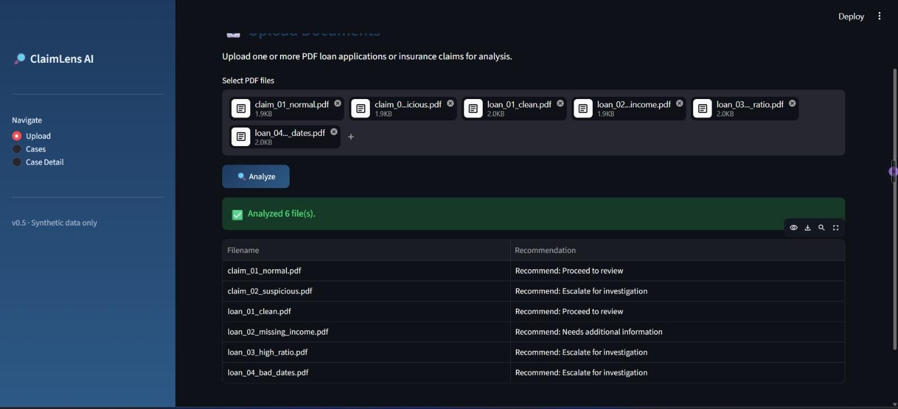
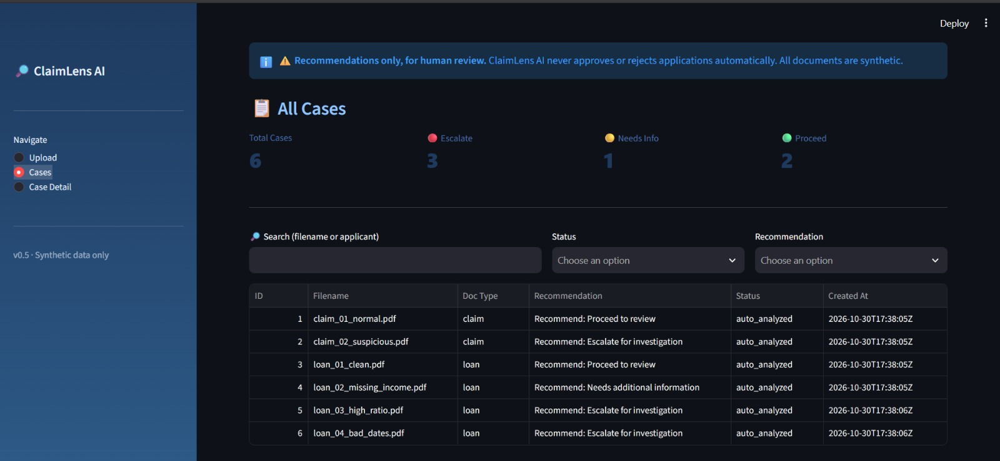
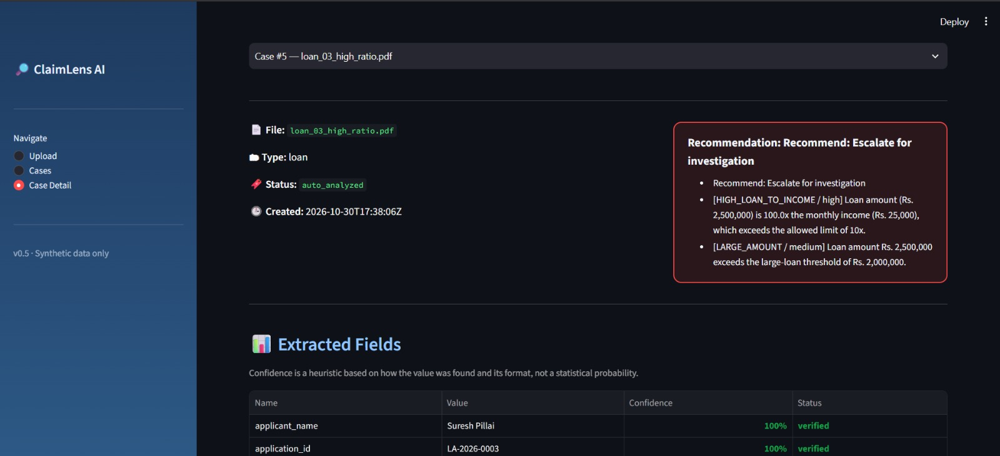
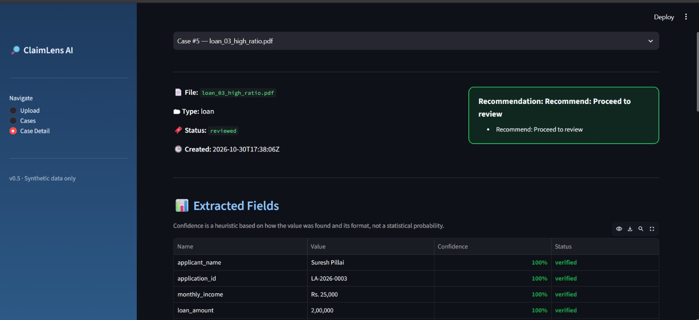
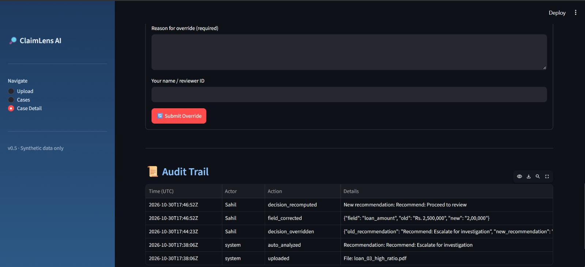

# ClaimLens AI

**Explainable Document Intelligence & Decision Support for loan applications and insurance claims.**

ClaimLens AI reads PDF documents, extracts key fields with confidence scores, validates them, and applies transparent business rules to produce a *recommendation with plain-English reasons*. A human reviewer can correct fields or override the recommendation, and every action is recorded in an audit trail.

> All documents in this project are **synthetic**. Outputs are **recommendations for human review**, not real approvals or rejections.

## Screenshots
| Upload | Cases dashboard |
|---|---|
|  |  |

| Case detail | Human review | Audit trail |
|---|---|---|
|  |  |  |

## Features
- **PDF extraction** with pdfplumber and regex (exact and fallback patterns)
- **Field confidence scoring** (1.0 / 0.7 / 0.4 / 0.0) with verified / needs_review / missing status
- **Validation engine**: missing fields, invalid values, future dates, end date before start date, incident before policy start
- **Explainable rule engine** (OOP): income-to-loan ratio, large amounts, missing critical fields, low confidence
- **Three recommendation levels**: Proceed to review, Needs additional information, Escalate for investigation
- **Human-in-the-loop**: correct extracted fields (decision is recomputed) and override recommendations with a mandatory reason
- **SQLite audit trail** of uploads, analysis, corrections, recomputations and overrides
- **Streamlit UI** with searchable, filterable case list and case detail pages

## How it works
`PDF -> PDFExtractor -> Validator -> DecisionEngine -> CaseRepository (SQLite) -> Streamlit UI`

| Module | Responsibility |
|---|---|
| `claimlens/extraction.py` | Reads PDFs, extracts fields, assigns confidence |
| `claimlens/validation.py` | Data-quality and logic checks |
| `claimlens/rules.py` | Abstract `Rule` class, rule subclasses, `DecisionEngine` |
| `claimlens/repository.py` | SQLite storage and audit log |
| `claimlens/services.py` | Orchestrates the full pipeline |
| `ui/pages.py` | Streamlit pages |

## Run locally
```bash
git clone https://github.com/sahiltilani0713/claimlens-ai.git
cd claimlens-ai
python -m venv venv
venv\Scripts\activate
pip install -r requirements.txt
python scripts/make_samples.py
streamlit run app.py
```

## Limitations (honest notes)
- **Confidence is a heuristic** (how the value was found and whether its format is valid), not a statistical probability.
- Decisions come from fixed, transparent rules. No machine learning is used and no accuracy is claimed.
- Works on text-based PDFs with labelled fields; scanned documents (OCR) are not supported yet.
- Synthetic data only.

## Roadmap
Missing-document detection, multi-document comparison, analytics dashboard, PDF reports, OCR.

## Author
Sahil Tilani - B.Tech Software Engineering (NIAT x VGU) | BS Data Science (IIT Madras)